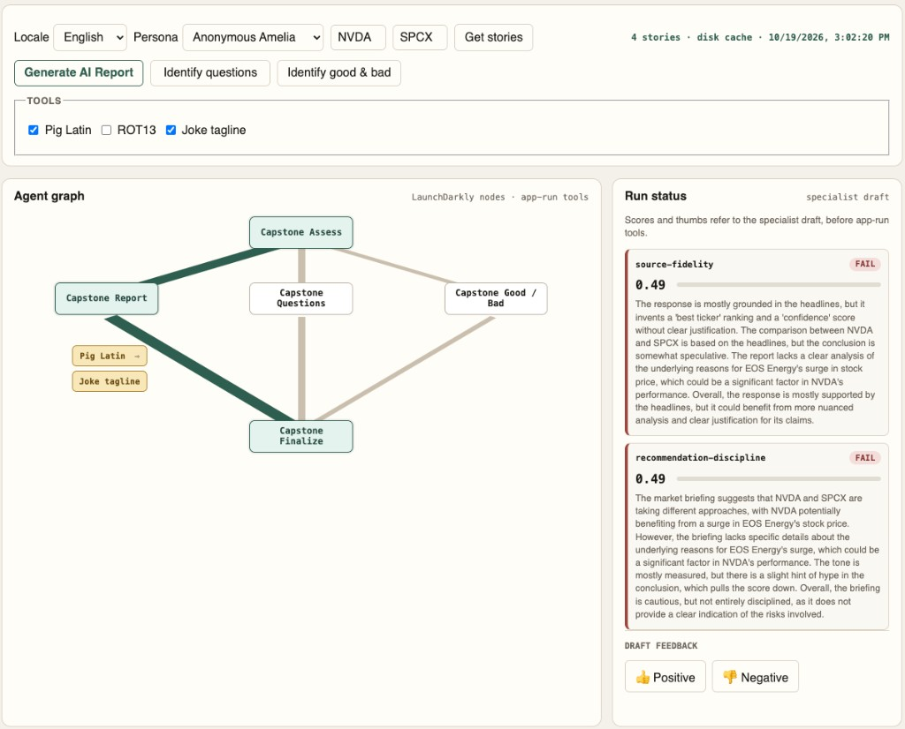
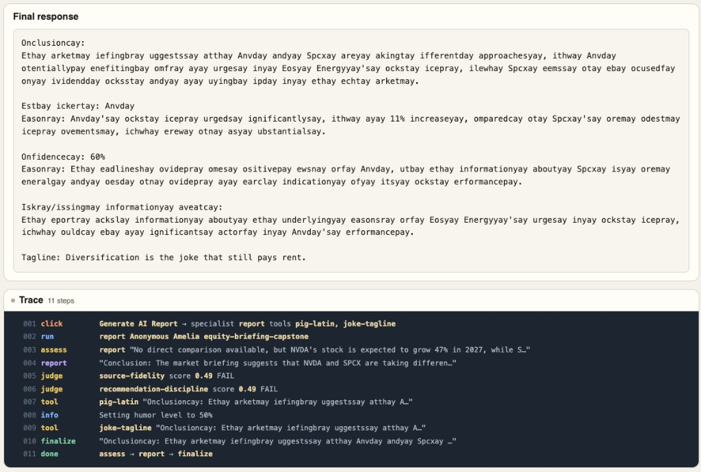

# 20-capstone

**Status: Python :8290, Node :8291, Java :8292, and .NET :8293 are built. Not in the series portal.**

One equity briefing that composes [21](../21-agent-completion-config/) through [25](../25-agent-graph/). Those folders stay the single-idea lessons. This app is where they meet. [26](../26-flags-vs-agent-control/) stays the flag comparison.

The graph is assess → specialist → finalize. There is no joke specialist. Pig Latin, ROT13, and a joke tagline are checkboxes, none checked by default. The app runs the checked tools after the specialist and before finalize, in that order. The model cannot skip them. Judges score the specialist draft, and thumbs record that same draft. The response panel shows the text after tools and finalize.

Python **8290**, Node **8291**, Java **8292**, and .NET **8293**. English and Spanish live here, and only here. The series portal stays on `21`–`26`. Lesson 27 can still take the `827x` ports.

Spec: [application.md](application.md).

Keywords: **AgentControl** · **agent graphs** · **Library tools** · **judges** · **tracked completion**

| Topic | Docs |
|-------|------|
| Agent graphs | [Agent graphs](https://launchdarkly.com/docs/home/agentcontrol/agent-graphs) |
| Tools | [Tools](https://launchdarkly.com/docs/home/agentcontrol/tools) |
| Judges | [Judges](https://launchdarkly.com/docs/home/agentcontrol/judges) |
| AgentControl | [AgentControl](https://launchdarkly.com/docs/home/agentcontrol) |

## What you will see

Generate runs the graph. The tool row adds each checked name to the on-screen graph immediately, and the trace shows that step when it runs. The rail shows the judge scores and the feedback event for the specialist draft.

A locale control chooses English or Spanish for the chrome and for the prompts the config serves. Persona names stay `Charlie`, `Amelia`, and `Toby`.

### Example: Generate AI Report, Pig Latin and joke tagline

Anonymous Amelia, English, NVDA and SPCX. Pig Latin and Joke tagline are checked. ROT13 is not. The lit path is assess → report → finalize. The tool boxes sit on the report branch. Both judges score the specialist draft and fail at 0.49. Those scores stay on the English draft. The final response is Pig Latin, and the tagline stays readable because that tool runs after the cipher. The trace records the click, both tools, Amelia's 50% humor line, and `assess → report → finalize`.

## Implementation

| Language | Directory | Status |
|----------|-----------|--------|
| Python web | `python/` | Built. Port **8290** |
| Node web | `node/` | Built. Port **8291** |
| Java web | `java/` | Built. Port **8292** |
| .NET web | `dotnet/` | Built. Port **8293** |
