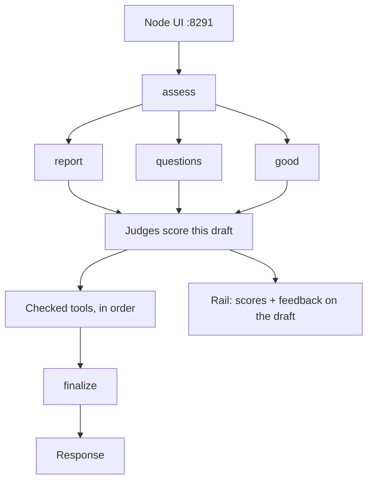

# AgentControl capstone — application specification

**Status: Node app built. Port 8291. Not in the series portal.**

One Node briefing composes the lessons in `21`–`25`. Those folders stay the single-idea lessons. This app is where they meet. `26` stays the flag comparison and does not roll in here.

Human overview: [README.md](README.md).  
Series setup: [20-agent-config README](../README.md).

## Goal

1. **Graph** ([25](../25-agent-graph/)): assess → specialist → finalize. The joke specialist branch is not in this graph.
2. **Tools** ([23](../23-agent-tools/)): three Library tools the learner checks. The app runs the checked ones. The model cannot skip them.
3. **Judges** ([24](../24-agent-judges/)): both judges score the specialist draft. The scores do not rewrite it.
4. **Feedback** ([22](../22-config-outside-code/)): thumbs record that same draft.
5. **Completion** ([21](../21-agent-completion-config/)): personas and report-node targeting. This app does not replace that lesson.

`21` is the completion-config base. The capstone does not reuse `equity-briefing-completion` or `equity-briefing-graph`.

Keywords: **AgentControl** · **agent graphs** · **Library tools** · **judges** · **tracked completion** · **locale**

| Topic | Docs |
|-------|------|
| Agent graphs | [Agent graphs](https://launchdarkly.com/docs/home/agentcontrol/agent-graphs) |
| Tools | [Tools](https://launchdarkly.com/docs/home/agentcontrol/tools) |
| Judges | [Judges](https://launchdarkly.com/docs/home/agentcontrol/judges) |
| AgentControl | [AgentControl](https://launchdarkly.com/docs/home/agentcontrol) |
| AI SDK | [AI SDKs](https://launchdarkly.com/docs/sdk/ai) |

## Run order

1. Assess routes to `report`, `questions`, or `good`. Unknown assess output falls through to `report`.
2. The specialist writes the draft.
3. Both judges score that draft. Thumbs feedback, when sent, records that same text.
4. Each checked tool runs on the draft, in this order: Pig Latin, ROT13, joke tagline. Unchecked tools do not run.
5. Finalize polishes the transformed text.
6. The response panel shows the finalized text.

The screen text and the judged text differ once any tool is checked. The rail says so: scores and feedback refer to the specialist draft, and the response is the text after tools and finalize.

## Screen

Node only. Port **8291**, so lesson 27 can still take the `8271` slot.

| Surface | What the learner sees |
|---------|------------------------|
| Actions | Generate AI Report, Identify questions, Identify good & bad. No joke button |
| Tools | Pig Latin, ROT13, and joke tagline. None checked by default |
| ROT13 back | Shown beside the final response only after a run that used ROT13. Checking it applies ROT13 again to the whole response, including the tagline |
| Graph | Box-and-edge topology matching example 25 and the LaunchDarkly graph. Checked tool boxes sit between the specialist tier and finalize, then light when run |
| Trace | Fixed-width, color-coded console: nodes, both judges, checked tools, finalize, and feedback |
| Rail | Status cards for both judge scores and the draft feedback event |
| LD details | Sent / Received / About drawer for context, variables, served nodes, judges, tools, and path |
| Locale | English or Spanish. Chrome and served prompts follow the control |

Persona context keys stay `Charlie`, `Amelia`, and `Toby`. The locale control does not rename them.

A run with no trace, no judge score, and no feedback event fails the lesson. A run with every tool unchecked still passes when those three are present. A checked tool that does not appear in the trace fails the lesson.

## Tools

Library tools. Schemas live in LaunchDarkly. Handlers are deterministic app code. The checkbox forces the call. The model is not offered the choice, because these transforms do not help it write the draft and it would skip them.

| Order | Key | What it does |
|-------|-----|----------------|
| 1 | `pig-latin` | Converts the current text to Pig Latin |
| 2 | `rot13` | Converts the current text to ROT13 |
| 3 | `joke-tagline` | Appends a joke as a tagline. The joke stays after the ciphers, so it stays readable |

Each execution calls `track_tool_call` on the specialist run. The visible graph is the teaching diagram: tool names sit on the phase between the specialist and finalize. They are not extra nodes in the LaunchDarkly agent graph. The graph edges stay assess → specialist → finalize.

The joke tagline replaces example 25's joke specialist. There is no `joke` node and no joke action. When the tagline tool runs, the trace can still show the code-only humor line from the persona: Charlie 25%, Amelia 50%, Toby 90%.

Example 23's `analyze-ticker-stories` and `compare-ticker-analyses` stay in that lesson. This app does not also run that model tool loop.

## Judges and feedback

Judges run at 100% on the specialist draft, before tools. Threshold and judge models follow [24](../24-agent-judges/application.md). A failing score is shown. It does not rewrite the draft and it does not choose Charlie, so the tool steps keep a stable input.

| Name | Key |
|------|-----|
| Capstone source fidelity | `equity-briefing-capstone-source-fidelity` |
| Capstone recommendation discipline | `equity-briefing-capstone-recommendation-discipline` |

Metric keys keep the `$ld:ai:judge:` prefix, with a capstone suffix so they do not collide with example 24.

Feedback is the example 22 thumbs control. The recorded text is the specialist draft, the same text the judges scored. Finalize and the tools do not change that event.

## LaunchDarkly resources

Dedicated keys. `21`–`25` keep the configs they already use.

### Agent graph

| Attribute | Value |
|-----------|-------|
| Name | `Equity briefing capstone` |
| Key | `equity-briefing-capstone` |
| Root | `equity-briefing-capstone-assess` |

| From | To | When |
|------|-----|------|
| assess | report | `specialist=report`, or assess output is missing |
| assess | questions | `specialist=questions` |
| assess | good | `specialist=good` |
| report / questions / good | finalize | after the judge and the checked tools |

### Agent-mode node configs

| Name | Key | Role |
|------|-----|------|
| Capstone assess | `equity-briefing-capstone-assess` | Router |
| Capstone report | `equity-briefing-capstone-report` | Briefing. Persona targeting lives here |
| Capstone questions | `equity-briefing-capstone-questions` | Two or three gap questions |
| Capstone good | `equity-briefing-capstone-good` | Good and bad, one response |
| Capstone finalize | `equity-briefing-capstone-finalize` | Polish the transformed text |

Assess and finalize are persona-agnostic. Report targeting follows example 25: Charlie cautious, Amelia fallthrough, Toby reckless. Nodes use agent mode. Provider is Ollama, `llama3.2:3b` by default.

Provisioning is REST under `rest/` for this app's configs, graph, tools, and judges only.

## Locale

English and Spanish are in scope for this app only. The rest of the catalog stays English.

- UI strings live in this app.
- Assess, questions, good, and finalize have a `spanish` variation. A `locale` = `es` rule serves it. Fallthrough stays the English variation.
- The report node keeps the Charlie / Amelia / Toby name rules. Spanish there comes from `{{ locale }}` inside each persona variation, so those rules stay intact.
- Headlines may stay English. The prompt tells the model which language to write.
- Pig Latin and ROT13 then run on whatever text the specialist wrote.

## Story persistence

Successful story pairs are written to the shared
`20-agent-config/stories/stories_cache.json` file. Bootstrap returns the last
usable pair, so the page restores stories after the Node process or browser
restarts.

## Leave in place

- [21](../21-agent-completion-config/) through [25](../25-agent-graph/) — single-idea lessons, all languages they already have.
- [26-flags-vs-agent-control](../26-flags-vs-agent-control/) — the flag-versus-config comparison.
- Series portal stays on `21`–`26`. This app is not a portal tab.
- Number **27** stays free for the next single-idea lesson.

## When implementing

1. Node web on **8291**. One Generate runs the path above.
2. REST scripts create only the capstone keys.
3. The tool row updates the on-screen graph before Generate.
4. Trace and rail distinguish the specialist draft from the finalized response.
