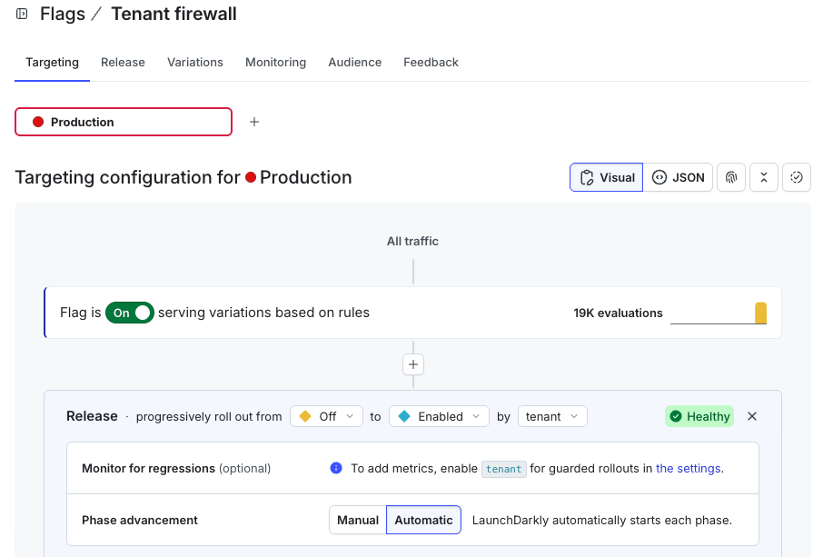
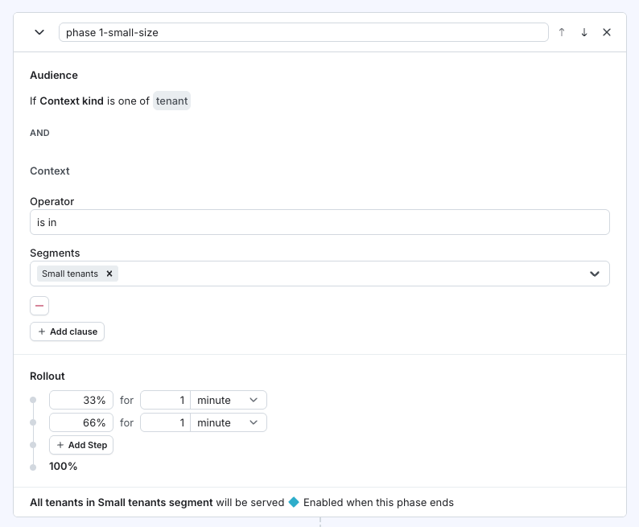
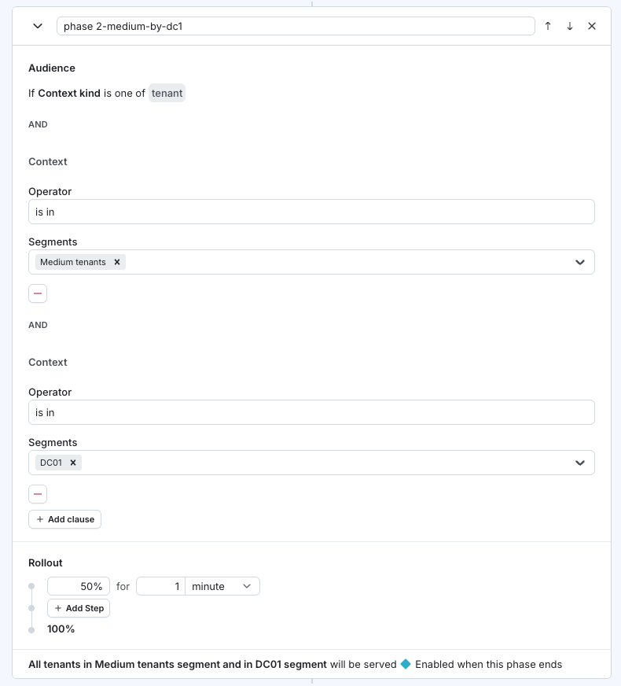
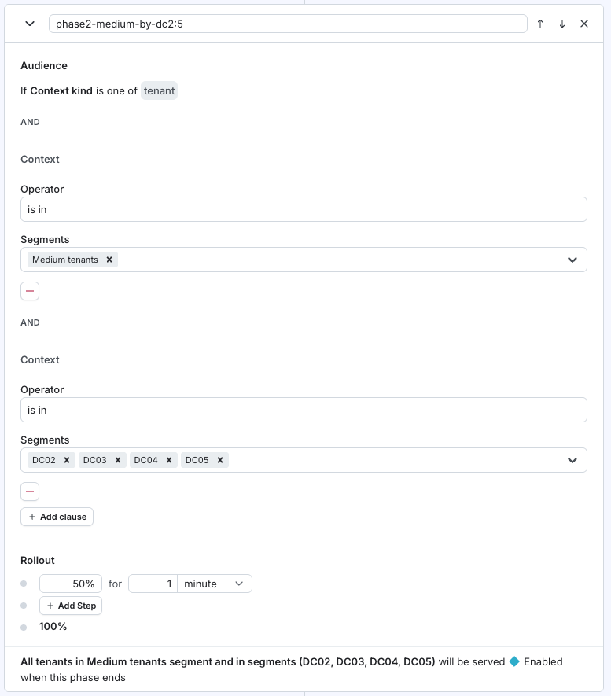
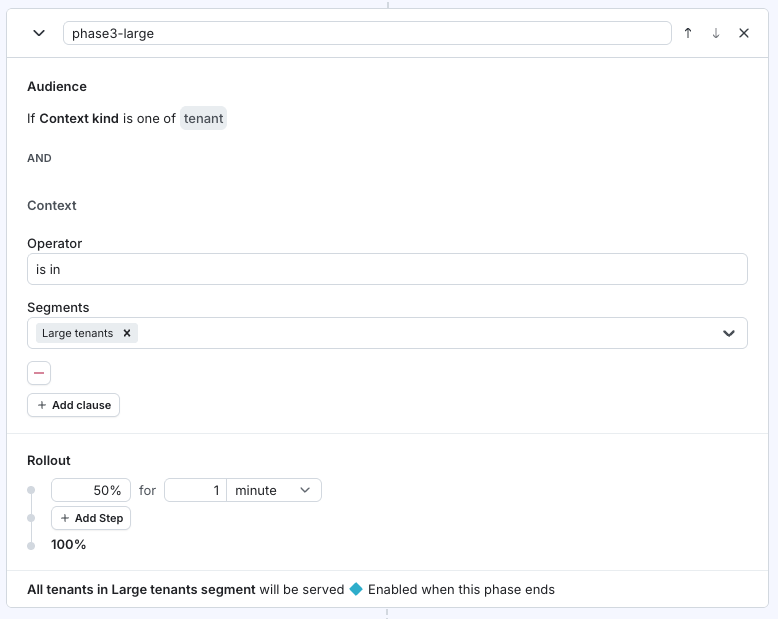
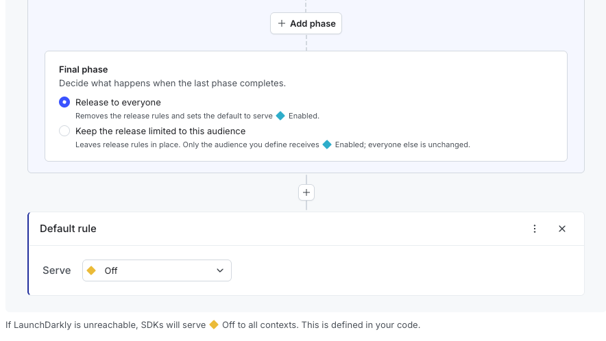
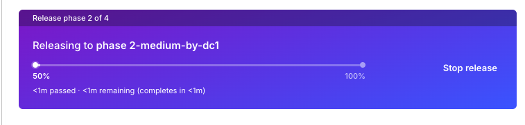

# 21-tenant-datacenters

Five datacenters, 52 generated tenants. Each presence is one evaluation.
Two flags style the floor: a border palette, and a fill of that hue.
`tenant-security` then releases a lock in waves: by name, by datacenter for Large, or a full deployment.
Version starts at 0, drawn as `7.0`.

The official shape is thousands of tenants across more than a dozen
datacenters. This lab keeps the same idea and shrinks the numbers.

Keywords: **feature flags** · **multivariate variations** · **boolean variations** · **segments** · **targeting rules** · **contexts**

Docs: [Variations](https://launchdarkly.com/docs/home/flags/variations) ·
[Boolean variations](https://launchdarkly.com/docs/home/flags/boolean) ·
[Segments](https://launchdarkly.com/docs/home/flags/segments) ·
[Contexts](https://launchdarkly.com/docs/home/flags/contexts)

## The floor

52 names, 106 boxes. A name that spans datacenters is drawn once in each.
Within a datacenter the boxes run small, medium, large, then unknown.

| Datacenter | Boxes |
|------------|------:|
| DC01 | 22 |
| DC02 | 21 |
| DC03 | 21 |
| DC04 | 21 |
| DC05 | 21 |

Names come from two passes of A–Z. Vowels are Large. Q and Z are unknown.
Otherwise `(letter number − 1) % 3` picks Medium (2) or Small (0 or 1). Each
size has its own counter, and odd or even is that number.

| Instance | Datacenters | Size in each |
|----------|-------------|--------------|
| Odd Small | 1 | 1 |
| Even Small | 2 | 2 |
| Odd Medium | 1 | 5 |
| Even Medium | 3 | 5 |
| Odd Large | 3 | 7 |
| Even Large | 5 | 7 |
| Unknown | 1 | 3 |

One cursor walks DC01–DC05 and wraps. A customer takes the next N datacenters.
The same name is drawn in each. An even Large takes all five, so the next
customer starts where that Large started.

A is `L01`, size 7 version 0, drawn as `7.0`, in DC01, DC02, and DC03. B is
`S01`, size 1, in DC04.

## Flags

| Flag | Variations | Off serves |
|------|------------|------------|
| `tenant-border-palette` | `none`, `roygbiv`, `contrast`, `earth`, `ocean`, `color-vision-aware` | `none` |
| `tenant-box-fill` | true, false | false |
| `tenant-security` | true, false | false |
| `tenant-firewall` | true, false | false |

One variation for every tenant. Size class picks the hue inside the palette,
so every Small is the same color in every datacenter. Yellow and orange stay
out of ROYGBIV so the light name still reads on a tinted fill. Fill with no
palette paints nothing.

Turning the border flag on, with no other rule, serves `roygbiv`. The Toggles
tab does that with the same on/off and fallthrough control as the 10-series.
It needs `LD_API_ACCESS_TOKEN`, `LD_PROJECT_KEY`, and `LD_ENVIRONMENT_KEY`
on the server. The palette applies to every box.

## Toggles

The Toggles tab is first. It controls `tenant-border-palette`, `tenant-box-fill`,
`tenant-security`, and `tenant-firewall`. The border card keeps the palette
picker. Each boolean card has On, Off, and Enable for everybody.

On serves the true variation. If a progressive rollout is already the default
rule, On leaves that rollout and turns the flag on. Off only turns the flag
off. Rules, targets, and the default rule stay. Enable for everybody turns
the flag on and serves the true variation from the default rule. Turning a
flag on plays a rising pair, 659 Hz then 880 Hz. Turning it off plays those
notes downward. Click the page once so the browser will play them.

[Boolean variations](https://launchdarkly.com/docs/home/flags/boolean) ·
[Multivariate variations](https://launchdarkly.com/docs/home/flags/variations)

## Fill rollout

The Manual tab links to `tenant-box-fill` in this project and environment.
Start the progressive rollout there. The default rule runs five one-minute
steps, then stays at full:

| Minute | Tenants filled |
|--------|----------------|
| 0–1 | 5% |
| 1–2 | 10% |
| 2–3 | 25% |
| 3–4 | 50% |
| 4–5 | 75% |
| After 5:00 | 100% |

Use context kind `tenant`, from Empty to Fill. A tenant that fills stays
filled, in every datacenter that name occupies. The Manual tab shows the step
and the time left in it. Click the page once. The start, each later
percentage, and the finish each play a tone. Trace records flag toggles and
stage changes. Reset
turns the flag off and serves Empty, so the
rollout can be created again. A new rollout may choose a different set of
tenants.

[Progressive rollouts](https://launchdarkly.com/docs/home/releases/progressive-rollouts)

## Security waves

`tenant-security` draws a lock. Three starts on the Automatic tab. By name waits
10 seconds between tenants. By datacenter waits 10 seconds between
datacenters. Full deployment waits 10 seconds between steps. The lab writes
the next change. The security panel counts down the last 5 seconds before that change.
Unknown stays off. Reset removes the targets and the rules
and turns the flag off. A tone marks the start, the next size or datacenter,
and the end. Names inside one size stay quiet.

By name adds one individual target every 10 seconds: `S01`, then `S02`, through
Small, Medium, and Large. That is 48 steps. A name that spans datacenters
locks in every datacenter at once, because those contexts share a key. The
Small chip pulses while Small is still releasing. It goes solid when `S28`
is out. Medium starts pulsing at `M01`. The line under the timer reads
`Small · by name · S07`.

By datacenter adds one rule every 10 seconds for Large only: `DC01`, then `DC02`,
through `DC05`. The rule matches `tenant-size-large` and `tenant-dc-01`,
then the next datacenter segment. The same large name can show the lock in
`DC01` and stay open in `DC02`. Small and Medium stay off. The line reads
`Large · by datacenter · DC03`. Five steps.

Full deployment walks Small, then Medium, then Large. Small is two rules:
size 1, then size 2. An odd Small is size 1 in one datacenter. An even Small
is size 2 in two, and both lock together. Medium adds one rule per
datacenter, `DC01` through `DC05`, matching `tenant-size-medium` and
`tenant-dc-0N`. The same medium name can lock in one datacenter and stay
open in another. Large then targets `L01`, then `L02`, through `L10`. A
large name locks in every datacenter it occupies. Each step waits 10
seconds. The line reads `Small · full deployment · size 1`, then
`Medium · full deployment · DC01`, then `Large · full deployment · L01`.
Seventeen steps.

[Individual targets](https://launchdarkly.com/docs/home/flags/individual-targeting) ·
[Targeting rules](https://launchdarkly.com/docs/home/flags/targeting-rules) ·
[Segments](https://launchdarkly.com/docs/home/flags/segments)

## Firewall

`tenant-firewall` draws a firewall icon. True shows it. Off draws nothing.
The Manual tab links to the flag. You build the release in LaunchDarkly.
The server SDK hears the flag change on its stream and tells the open page
to fetch the layout. The floor redraws in place, without a browser refresh.
Unknown stays off until the final phase.

Turn the flag on, then choose Release. Roll out from Off to Enabled, by
`tenant`. Set phase advancement to Automatic, so LaunchDarkly starts the
next phase when the current one reaches 100%. Each phase needs one
progressive step before that 100%. The default rule stays Off. If
LaunchDarkly is unreachable, this lab also serves Off.

[Audience-based releases](https://launchdarkly.com/docs/home/releases/audience-based-releases) ·
[Progressive rollouts](https://launchdarkly.com/docs/home/releases/progressive-rollouts) ·
[Boolean variations](https://launchdarkly.com/docs/home/flags/boolean)



1. **phase 1-small-size.** Context kind `tenant`, operator is in, segment Small tenants. 33% for 1 minute, then 66% for 1 minute, then 100%. Every Small tenant is Enabled when the phase ends.



2. **phase 2-medium-by-dc1.** Two clauses, combined with and: Medium tenants, and DC01. 50% for 1 minute, then 100%. Medium boxes in DC01 are Enabled when the phase ends. The same name in another datacenter stays off.



3. **phase2-medium-by-dc2:5.** Medium tenants, and DC02, DC03, DC04, DC05 in the second clause. 50% for 1 minute, then 100%. Medium boxes in those four datacenters are Enabled when the phase ends.



4. **phase3-large.** Large tenants. 50% for 1 minute, then 100%. Every Large box is Enabled when the phase ends.



5. **Final phase: Release to everyone.** This removes the release rules and sets the default to Enabled. Unknown gets the icon here. The other choice, keep the release limited to this audience, leaves everyone else unchanged.



While a phase is running, LaunchDarkly shows the phase name and the percentage still to go. The floor follows that on its own.



| Palette | Small | Medium | Large | Unknown |
|---------|-------|--------|-------|---------|
| roygbiv | blue | green | red | violet |
| contrast | cyan | gold | magenta | lime |
| earth | moss | amber | wine | river |
| ocean | blue | coral | seafoam | sand |
| color-vision-aware | sky blue | orange | bluish green | reddish purple |

`contrast` replaces `grays`. A gray ramp has no hue to separate. Earth and
ocean keep a theme, with the size classes farther apart. `color-vision-aware`
uses four [Okabe–Ito](https://jfly.uni-koeln.de/color/) hues. They stay distinct
for typical color vision and for the common red-green deficiencies. The name
is a reminder that one palette does not cover every type of color-vision
deficiency.

## Segments

Rules on the `tenant` context. The color flags do not use them. The
datacenter wave matches `tenant-size-large` together with one
`tenant-dc-0N` segment. Full deployment matches Small on the size
attribute, and Medium with `tenant-size-medium` plus one datacenter
segment. The name wave, and Large in a full deployment, use individual
targets. A tenant
in all five datacenters also matches multi-site.

| Segment | Attribute |
|---------|-----------|
| `tenant-size-small` `tenant-size-medium` `tenant-size-large` `tenant-size-unknown` | `sizeClass` |
| `tenant-dc-01` … `tenant-dc-05` | `datacenter` |
| `tenant-footprint-single` | `span` is 1 |
| `tenant-footprint-multi` | `span` is 2, 3, or 5 |
| `tenant-footprint-all-five` | `span` is 5 |

Create them with [rest/create-all.sh](rest/create-all.sh).

## Customization

Copy [customizations.json.example](customizations.json.example) to
`customizations.json` in this directory. Set `companyName`, `logo`, and
`colors`. The logo is a file name in this directory, next to the example SVG.
`colors` is the page chrome. Each value is `#RGB` or `#RRGGBB`.

| Key | Paints |
|-----|--------|
| `background` | Page behind the datacenters |
| `panel` | Datacenter cards and the lab drawer |
| `ink` | Main text |
| `muted` | Secondary text |
| `line` | Borders |
| `accent` | Links, the active tab, and the countdown |

The local copy is gitignored. If it is missing, the page uses the example
values. A missing color key stays the lab default.

## Run

```bash
cd python
pip install -r requirements.txt
python 21-tenant-datacenters.py
```

Open http://127.0.0.1:8080/. `PORT` overrides the port. `LD_SDK_KEY` is the
server SDK key for the environment where the flags and segments live. Without
it, the border stays the hairline and the boxes stay empty.

## Later

Version releases still to wire: percentage rollout, progressive rollout, and
guarded rollout, moving instances from 0 through 9. Also bold, italic, and
icons in the open middle: database, robot, then a failure
icon and an over-utilized icon. The lock is `tenant-security`. The firewall
is `tenant-firewall`.
