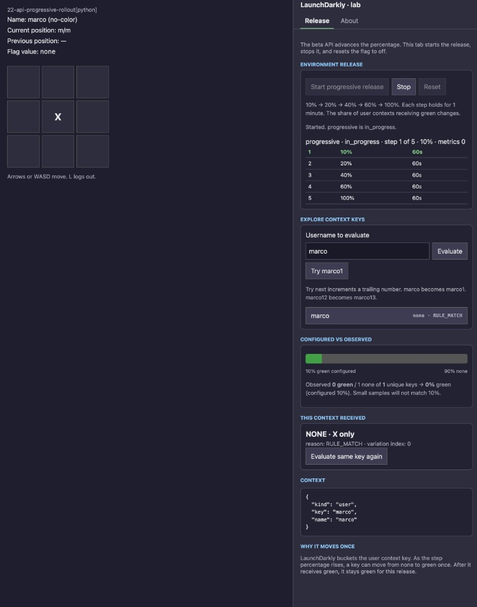
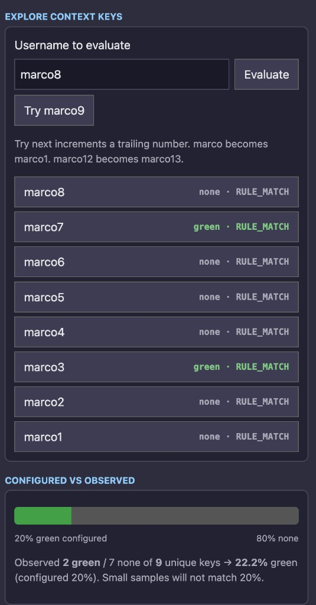

# 22-api-progressive-rollout

Start a progressive rollout with the environment releases beta API. The grid highlight moves from `none` to `green` in five steps: **10%**, **20%**, **40%**, **60%**, **100%**. Each step lasts **1 minute**.

Example 14 uses the same schedule and finishes the rollout in the UI. This example `POST`s the release. No metrics are included, so the release kind is **progressive**.

The API will not release the default rule. The start call creates one rule whose clause matches every `user` context.

## Prerequisites

```bash
export LD_API_ACCESS_TOKEN="api-..."
export LD_PROJECT_KEY="your-project"
export LD_ENVIRONMENT_KEY="your-environment"
export LD_SDK_KEY="sdk-..."
```

## Run

```bash
cd rest
chmod +x *.sh
./create-flag.sh
```

In another terminal, start one grid and log in once. That gives the flag a recent user evaluation, which the start health check looks for. Python is **:8780**, Node **:8781**, Java **:8782**, .NET **:8783**.

```bash
cd python && python 22-api-progressive-rollout.py          # :8780
cd node && npm install && npm start                        # :8781
cd java && ./mvnw -q -DskipTests package && java -jar target/22-api-progressive-rollout.jar  # :8782
cd dotnet && dotnet run                                    # :8783
```

Run one of those. The consoles only read the flag. Start the release from a web grid, then watch it in a console. Each one re-evaluates every 500 ms and accepts `--evaluate-once alice`.

```bash
cd python-console && python 22-api-progressive-rollout.py
cd node-console && npm install && npm start
cd java-console && ./mvnw -q -DskipTests package && java -jar target/22-api-progressive-rollout.jar
cd go && go run .
cd rust && cargo run
cd cpp && make && ./22-api-progressive-rollout
```

Open the matching port and log in. On the Release tab, click **Start progressive release**. **Stop** rolls that release back to `none` and leaves the phase rule. **Reset** stays available, turns the flag off, and removes that rule. Start removes it too, so a second release is not rejected as a duplicate description. **Try next** samples another username by incrementing a trailing number. The schedule is a percentage of user contexts at each step, held for a fixed time: **10%**, **20%**, **40%**, **60%**, **100%**, one minute each.

A click on the page unlocks audio, the same tones as [21-tenant-datacenters](../21-tenant-datacenters/). Start is one note. Each later step is a short pair. Finish is the rising pair.

Elapsed time sits under the release summary. It starts when the page notices the current step and resets when the next step appears. The release poll is every 5 seconds, so the clock can lag the change in LaunchDarkly by a few seconds. Stop and Reset clear it.

Step 1 holds at 10%. `marco` is outside that bucket, so the cell stays dark. The reason is `RULE_MATCH` and the variation index is 0. One sample at 10% can easily be `none`.



**Try next** walks the trailing number: `marco1`, then `marco2`. At the 20% step, `marco3` and `marco7` are green and the rest of this sample is `none`. Two green keys out of nine is about 22%, next to the configured 20%. A small sample will not land on the step percentage.



`rest/start-progressive-release.sh` sends the same body.

```bash
cd rest
./get-progressive-release.sh
```

Shorter steps for a lab. The button uses the same variable when Python is started with it:

```bash
STAGE_SECONDS=30 python ../python/22-api-progressive-rollout.py
STAGE_SECONDS=30 ./start-progressive-release.sh
```

A flag with no recent evaluations fails `health_checks_failed`. Log in on the grid, or pass `--bypass-health-checks`.

Stop rolls the single phase back to `none` and removes it:

```bash
./stop-progressive-release.sh          # back
./stop-progressive-release.sh forward  # serve green now
```

One evaluation without the browser:

```bash
cd python && python 22-api-progressive-rollout.py --evaluate-once alice
```

## What the call does

`POST /api/v2/projects/{projectKey}/flags/{flagKey}/environments/{environmentKey}/releases`

Header: `LD-API-Version: beta`.

| Field | This example |
|-------|----------------|
| `originalVariationId` | `none` |
| `targetVariationId` | `green` |
| `randomizationUnit` | `user` |
| `metrics` | omitted |
| `phases` | one rule, five steps |
| `cleanupBehavior` | `remove_rules_and_update_default_rule` |

[Environment releases (beta)](https://launchdarkly.com/docs/api/environment-releases)

## Layout

| Piece | Where |
|-------|--------|
| Web grid | [python/](python/) **:8780**, [node/](node/) **:8781**, [java/](java/) **:8782**, [dotnet/](dotnet/) **:8783** |
| Console | [python-console/](python-console/), [node-console/](node-console/), [java-console/](java-console/), [go/](go/), [rust/](rust/), [cpp/](cpp/) |
| Start, read, stop | [rest/](rest/) |
| Flag only, off | [terraform/](terraform/) |
