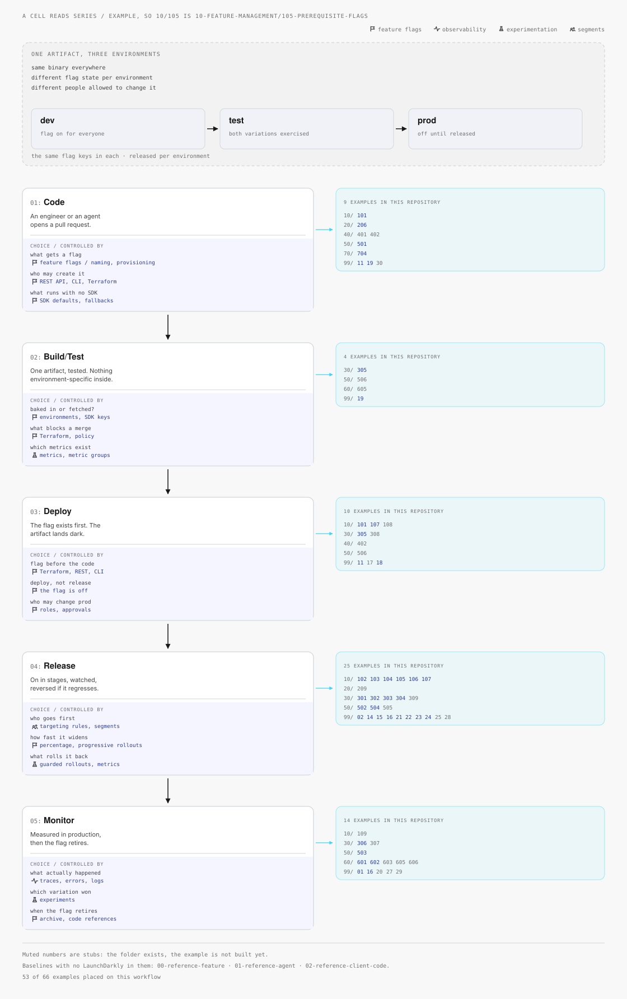
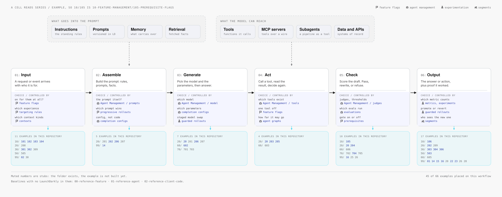

# diagrams

Two maps of where the examples in this repository fit into real work.

## Anatomy of a CI/CD Pipeline

Five stages, from a pull request to a retired flag. The figure is 1904px wide, so it
arrives here as a thumbnail — click it for full size.

[](cicd-pipeline.svg)

## Anatomy of an LLM Workflow

Six steps, from an incoming request to a checked answer.

[](llm-workflow.svg)

| File | What it is |
|------|------------|
| [cicd-pipeline.html](cicd-pipeline.html) · [cicd-pipeline.svg](cicd-pipeline.svg) | The pipeline, as a page and as an image |
| [llm-workflow.html](llm-workflow.html) · [llm-workflow.svg](llm-workflow.svg) | The LLM workflow, as a page and as an image |

Each diagram has two layers. The top layer is the workflow itself: a stage, the
choice it hides, and the LaunchDarkly capability that owns that choice. The second
layer, directly beneath each stage, names the examples here that demonstrate it.
**Every citation is a link to its folder.**

## Why each diagram exists twice

GitHub shows a committed `.html` file as source rather than rendering it, so each
figure is also written as a flattened `.svg`, which GitHub does render — above, and
in its own file view. That is why this folder has four files and no web server.

The `.svg` is rendered **as an image**, which costs it three things the page keeps:
the citations are not clickable, the typefaces fall back to whatever the reader has,
and there is no dark variant, so the figure carries its own light background. For
the clickable version, open the page from a clone:

```bash
open diagrams/cicd-pipeline.html
```

Citations link to `github.com` rather than to a sibling folder, so they survive being
opened from anywhere — including from a web server later, where a relative folder
link would 404, since a static host serves a directory only when it holds an
`index.html` and these folders hold a `README.md`. Run `build.py --local` for
relative links instead, for reading a clone offline.

## Reading a citation

A citation is the top-level folder number, a slash, and the example number:

```
10/105   ->  10-feature-management/105-prerequisite-flags
20/204   ->  20-agent-management/204-agent-judges
99/15    ->  99-use-cases/15-guarded-rollout
```

Numbers in blue are built. **Muted numbers are stubs** — the folder exists and the
example does not work yet. An example that fits more than one stage is cited at
each of them: `99/16` adaptive triggers is both a release control and a monitoring
one, so it appears under Release and under Monitor.

The three `0x-reference-*` folders carry no citation. They are the baselines with
no LaunchDarkly in them, and the diagrams name them in a footnote instead.

## Regenerating

```bash
python3 diagrams/build.py            # rewrite both pages and both images
python3 diagrams/build.py --check    # report unmapped examples, write nothing
python3 diagrams/build.py --local    # cite with relative links, for offline reading
```

`build.py` reads the example folders on every run, so the list of examples and
which of them are stubs always follow the repository. **Where** an example lands is
editorial and lives in the `PLACEMENT` table at the top of the script — one entry
per numbered example, giving its CI/CD stages and its LLM steps, either of which
may be empty.

Add an example to the repository and `--check` names it as unmapped until it has a
`PLACEMENT` entry. Rename or remove one and `--check` reports it as a ghost. Run
the check before a release so the diagrams do not quietly fall behind the code.

All four files are generated. Edit `build.py`, not the HTML and not the SVG.
